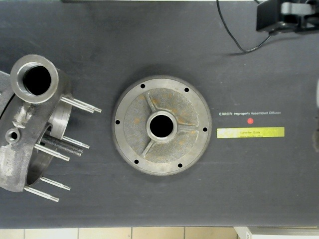
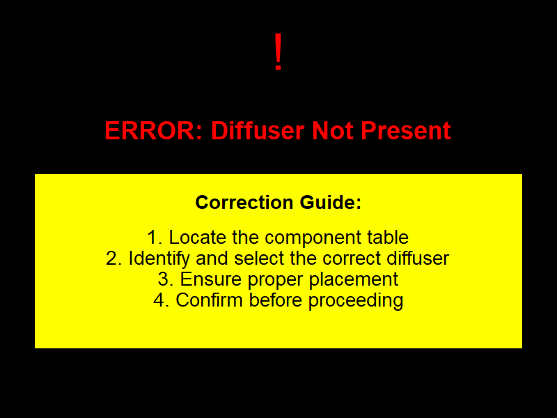
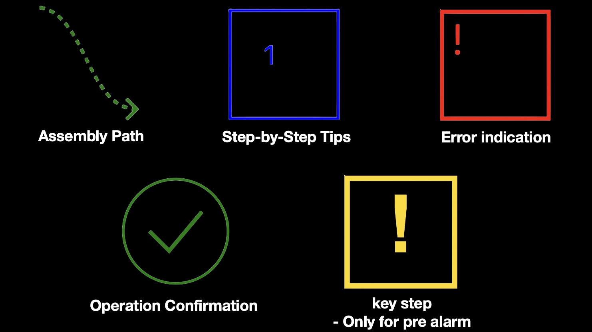

# Projector-Based Generative AI Assistant for Manual Assembly

A generative-AI assistive system for manual assembly that projects guidance onto the workpiece. A vision-language model checks each assembly step against a reference image. Before steps that historically go wrong, the system issues a preventive warning. When it detects an error, it delivers corrective guidance tailored to the operator. The main channel is **visual cues projected onto the workbench by a DLP® projector**; spoken instructions are the secondary channel. The operator wears nothing, so the system needs no head-mounted display.

<p align="center">
  
</p>

> **Status:** laboratory-scale research prototype. It is not intended for production or safety-critical use.

---

## How it works

The system is organised in five interconnected layers:

| Layer | Role | Modules |
|---|---|---|
| **Data management** | Stores assembly task data, error-history logs and operator profiles. Identifies *critical steps* from error statistics. | `data_management.py` |
| **Human** | The operator performs each step and receives instructions, warnings and corrections. | — |
| **Generative AI** | Runs reference-based error detection with a vision-language model, generates warnings and corrective instructions, and creates SVG visual cues. | `genai.py`, `visual_cues.py`, `prompts/` |
| **Hardware control** | Drives the DLP projector, the audio output and the workstation cameras. | `projector.py`, `audio.py`, `camera.py` |
| **User interaction** | Feedback learning. Operators correct misclassified detections, and guidance they rate as ineffective triggers a switch to the next-ranked guidance mode. | `feedback.py` |

### Assembly loop

For each step of the task sequence:

1. **Instruction.** The work instruction is announced by voice.
2. **Preventive warning.** If the step is *critical* (its recorded error count is above a threshold), the assistant generates a warning from that step's most frequent past errors and delivers it before the operator starts.
3. **Image acquisition.** When the operator reports the step as done, the top-view or side-view camera captures the assembly state.
4. **Error detection.** The model compares the captured image with the reference image. It looks only at the components and tools named in the instruction and returns a structured detection log (`Status: CORRECT / ERROR`, error description, correction instructions).
5. **Operator feedback.** If the operator disagrees with the analysis, they flag the problem area (error detection, error description or instruction generation) and add details. The step is then re-checked with this corrective prompt.
6. **Corrective guidance.** On error, concise corrective instructions are delivered in the operator's highest-ranked guidance mode:
   - **Projected visual cue:** a high-contrast SVG cue, rendered to PNG and projected onto the workbench;
   - **Voice:** the instructions are synthesised and played back.

   If the operator rates the guidance as unhelpful, the assistant switches to the next-ranked mode.
7. Steps 3–6 repeat until the step is verified as correct.

Every detection, warning, cue, piece of feedback and mode switch is written to a timestamped session log (JSON lines). The duration of each generative AI stage is printed during the session.

<p align="center">
  
  &nbsp;
  
</p>

## Hardware

| Component | Used for |
|---|---|
| **TI DLP® LightCrafter™ Display 2000 EVM + BeagleBone Black** | Projects visual cues; driven from the workstation over SSH/SFTP |
| Two USB webcams (top view and side view, 1280×720) | Capture the assembly state; the camera is chosen per step |
| Workstation PC (Windows, macOS or Linux) | Runs the assistant |
| Earphones or speakers | Play spoken instructions |

Setting up the projector (BeagleBone image, cape overlay, display script) is described in [`hardware/projector/README.md`](hardware/projector/README.md).

## Repository structure

```
.
├── src/projector_assembly_assistant/
│   ├── main.py              # Entry point: interactive assembly loop
│   ├── config.py            # Configuration, paths and secrets
│   ├── data_management.py   # Tasks, error history, critical steps, operator profiles
│   ├── genai.py             # Vision-language model: detection, warnings, instructions
│   ├── visual_cues.py       # SVG cue generation and PNG rendering
│   ├── projector.py         # SSH/SFTP controller for the DLP projector
│   ├── audio.py             # Text-to-speech and playback
│   ├── camera.py            # Image acquisition
│   ├── feedback.py          # Operator feedback and session logging
│   ├── gui.py               # Optional monitoring GUI
│   ├── utils.py             # Shared helpers
│   └── prompts/             # Prompt templates (editable plain text)
├── data/
│   ├── assembly_tasks.xlsx             # 14-step centrifugal pump assembly sequence
│   ├── error_history.sample.xlsx       # Sample error-history log
│   ├── operator_profiles.sample.xlsx   # Synthetic operator profiles
│   └── reference_images/               # Reference image for each step's correct state
├── hardware/projector/      # BeagleBone + DLP setup, display script, overlay
├── examples/                # Example detection log and generated cues
├── docs/images/             # Figures used in this README
├── config/config.example.ini
├── .env.example
├── pyproject.toml
├── requirements.txt
└── LICENSE
```

## Installation

Requires Python 3.10 or newer.

```bash
git clone https://github.com/itsycfan/projector-genai-assembly-assistant.git
cd projector-genai-assembly-assistant
python -m venv .venv
source .venv/bin/activate          # Windows: .venv\Scripts\activate
pip install -e .
```

System dependencies:

- **Cairo**, needed by CairoSVG: `brew install cairo` on macOS, `sudo apt install libcairo2` on Debian/Ubuntu. On Windows, install the GTK runtime.
- **SoX**, Linux only, for audio playback: `sudo apt install sox libsox-fmt-mp3`.

## Configuration

```bash
cp config/config.example.ini config/config.ini
cp .env.example .env                 # then fill in your own values
```

| Setting | Where |
|---|---|
| `OPENAI_API_KEY`, `PROJECTOR_PASSWORD` | `.env` or environment variables. **Never commit secrets.** |
| Model names, token limits, temperatures | `[Models]` |
| Projector host, remote directory, rotation | `[Projector]` |
| Critical-step threshold | `[CriticalSteps]` |
| Input data and output folders | `[Paths]` |

## Usage

```bash
projector-assistant                       # interactive session
projector-assistant --operator 2          # select the operator profile directly
projector-assistant --task S17.2          # run a single step
projector-assistant --no-projector        # save cues without projecting (desk testing)
projector-assistant --no-audio            # print voice messages instead of speaking
```

You can also test each component on its own:

```bash
python -m projector_assembly_assistant.projector path/to/image.png   # project an image
python -m projector_assembly_assistant.camera --camera 1             # capture a test image
python -m projector_assembly_assistant.audio "Test message"          # speech output
python -m projector_assembly_assistant.gui                           # monitoring GUI
```

Runtime outputs are written to `outputs/`, which git ignores:

| Folder | Contents |
|---|---|
| `captured_images/` | Camera captures |
| `detection_logs/` | Model detection logs |
| `visual_cues/` | Generated SVG/PNG cues |
| `audio/` | Synthesised speech |
| `sessions/` | JSON-lines session logs |

## Data format

**`assembly_tasks.xlsx`** has one row per step:

| Column | Description |
|---|---|
| `task ID` | Step identifier, e.g. `S15.2`. Must match a file in `data/reference_images/`. |
| `task type` | `Component selection`, `Tool selection` or `Assembly operation` |
| `required components` / `required tools` | Items involved in the step |
| `operation name` | Short name of the operation |
| `work instructions` | Instruction given to the operator and to the model |
| `Task Difficulty(1-3)` | Difficulty rating |
| `Camera` | Camera index: `1` = top view, `0` = side view |

**`error_history.sample.xlsx`** has one row per recorded error, with the columns `Step Number`, `Error Type`, `Error Description`, `Instruction Action Taken` and so on. A step counts as critical when its number of records is greater than `ERROR_THRESHOLD`.

**`operator_profiles.sample.xlsx`** has one row per operator. It holds their work experience, an optional cognitive profile, and preference weights (0–1) for the audio, visual, robot-assistance and robot-demonstration guidance modes. **All entries in the sample file are synthetic.**

## Customising the prompts

All prompts are plain-text templates in `src/projector_assembly_assistant/prompts/`, using `$placeholder` variables. You can adapt them to new tasks or products without changing the code.

## Limitations

- Model-based detection is probabilistic and can be affected by lighting, viewpoint and occlusion. This is why the operator-feedback loop is part of the design.
- An external generative AI API adds network latency and depends on the provider being available.
- The robot assistance and robot demonstration modes are represented in the operator profiles, but no robot control is included in this release; these modes are skipped.
- Projected cues are shown at a fixed position in the projector's field. They are not registered to the workpiece geometry.

## License

The code is released under the [MIT License](LICENSE). `hardware/projector/overlay/DLPDLCR2000-00A0.dts` is © Texas Instruments and licensed under GPL-2.0, as stated in its header.
